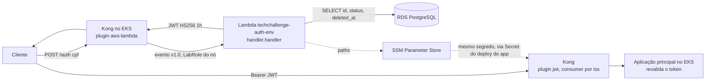

# Function Serverless de Autenticação — Tech Challenge Fase 3

Function Serverless (AWS Lambda) que autentica o **cliente da oficina pelo CPF**: valida o
documento, consulta a existência e o status do cliente na base gerenciada e devolve um
**JWT** válido para consumo das APIs protegidas. Quem chama a função é o **Kong**, o API
Gateway do projeto ([ADR-002](docs/ADRs/ADR-002-kong-invoca-a-funcao-sem-api-gateway.md)),
que também valida os tokens nas rotas protegidas com o plugin `jwt`.

É um dos quatro repositórios da Fase 3:

| Repositório | Papel |
|---|---|
| [TechChallange](https://github.com/DevKaue/TechChallange) | Aplicação principal em Kubernetes (Fases 1 e 2) |
| **TechChallange---Function-Serverless** (este) | **Function Serverless de autenticação por CPF** |
| [tech-challenge-database-infra](https://github.com/DevKaue/tech-challenge-database-infra) | Banco de dados gerenciado (Terraform) |
| [tech-challenge-app-](https://github.com/DevKaue/tech-challenge-app-) | Aplicação da Fase 3, com as rotas do Kong (ADR-005, RFC-001) |
| [TechChallenge---Infraestrutura-Kubernetes-com-Terraform](https://github.com/DevKaue/TechChallenge---Infraestrutura-Kubernetes-com-Terraform) | EKS, Kong e o segredo JWT no SSM |

> **Status: código da função completo, deploy pendente.** Domínio, caso de uso, adaptador
> HTTP (eventos v1.0 do Kong e v2.0), composição no cold start estão implementados e
> testados (unitário, integração com Postgres real e smoke E2E). Faltam a imagem, o
> Terraform da função e o workflow de deploy. Seções com comentário `M2`/`M5` ainda serão
> preenchidas.

## Propósito

| Função | Entrada | Handler | O que faz |
|---|---|---|---|
| `techchallenge-auth-<env>` | `POST /auth` com `{"cpf": "..."}`, invocada pelo plugin `aws-lambda` do Kong | `handler.handler` | Valida o CPF (formato e dígitos verificadores) antes de qualquer I/O, consulta existência e status do cliente no Postgres gerenciado e devolve um JWT HS256 de 1 h |

`<env>` é `staging` para a `develop` e `prod` para a `main`: é o único nome que o Kong tem
permissão de invocar.

A função monta as dependências na **primeira requisição** do container, lendo segredos e o
contrato de descoberta do banco pelo SSM, e reaproveita nas seguintes. Falha nessa montagem
vira **503 no contrato**, nunca 502. Ver
[ADR-001](docs/ADRs/ADR-001-composicao-no-primeiro-request-e-authorizer-sem-banco.md).

### Formato do evento

O Kong envia o evento no formato REST (v1.0), com `awsgateway_compatible: true` e o body em
base64. O handler também aceita o v2.0 do HTTP API, usado no teste local. A resposta é a
mesma nos dois: `{statusCode, headers, body}`, que o Kong repassa com
`is_proxy_integration: true`. O `X-Correlation-ID` gerado pelo plugin `correlation-id` do
Kong (`<uuid>#<n>`) é propagado para o log e para a resposta.

## Tecnologias utilizadas

| Camada | Tecnologia | Justificativa |
|---|---|---|
| Runtime | Node.js 22 + TypeScript | O validador de CPF é portado linha a linha da aplicação principal; duas implementações da mesma regra divergiriam num caso de borda, em produção |
| Empacotamento | Container image no ECR | Atende ao entregável de Dockerfile e permite embutir o bundle de CAs do RDS, fechando a dívida de TLS declarada no repositório-base |
| Banco | `pg` (driver direto), sem ORM | O schema pertence a outro repositório; um `schema.prisma` copiado seria uma segunda fonte de verdade que compila mesmo divergente |
| Token | `jsonwebtoken`, HS256 | Mesmo segredo e mesmo algoritmo da aplicação principal |
| Testes | Jest + Postgres em service container | Mesma estratégia do repositório-base |
| IaC | Terraform `~> 1.10` | Função, alias e observabilidade. A role de execução é a **LabRole** existente: o AWS Academy não permite criar roles |
| CI/CD | GitHub Actions com OIDC | Sem chave estática em secret de repositório |

## Passos para execução e deploy

### Testes locais

```bash
nvm use                      # Node 22
npm ci
npm run typecheck && npm run lint
npm test                     # unitários + contratos, com cobertura mínima global

npm run db:it:up             # Postgres 15.19 em Docker, porta 5432
npm run test:integration     # repositório e fluxo completo contra o banco real
npm run db:it:down
```

### Variáveis de ambiente da função

| Variável | Obrigatória | Exemplo |
|---|---|---|
| `APP_ENV` | sim | `staging` |
| `JWT_SECRET_SSM_PATH` | sim | `/techchallenge/staging/auth/jwt-secret` |
| `DB_SSM_PREFIX` | sim | `/techchallenge/staging/db` |
| `RDS_CA_BUNDLE_PATH` | não | padrão `/var/task/certs/global-bundle.pem` |

Só **paths** do SSM entram como variável, nunca valores. O segredo JWT é criado pelo
repositório de infraestrutura Kubernetes, e é o mesmo que o Kong e a aplicação usam. Os
parâmetros do banco (`host`, `port`, `name`, `username`, `password`) são publicados pelo
repositório [tech-challenge-database-infra](https://github.com/DevKaue/tech-challenge-database-infra).

### Smoke pós-deploy

```bash
API_URL=http://<nlb-do-kong> \
CPF_ATIVO=<cpf sintético do seed de homologação> \
PROTECTED_URL=http://<nlb-do-kong>/api/<rota de cliente> \
test/e2e/smoke-auth.sh
```

<!-- M5 — Dockerfile, Runtime Interface Emulator e deploy por alias com rollback -->

## Diagrama da arquitetura deste repositório



Fonte em [`docs/diagrams/01-autenticacao.mmd`](docs/diagrams/01-autenticacao.mmd).

## Contrato da API

<!-- M2 — a função NÃO é NestJS, então o OpenAPI não é gerado automaticamente:
     docs/api/openapi.yaml é escrito à mão e a coleção Postman é versionada em
     docs/postman/ -->

| Status | Quando |
|---|---|
| 200 | CPF válido, cliente existente e elegível |
| 400 | Formato ou dígito verificador inválido — sem tocar no banco |
| 401 | Cliente não cadastrado **ou** não elegível, indistinguíveis |
| 503 | Banco indisponível |

O 401 é deliberadamente indistinguível entre "não existe" e "não elegível": diferenciar
permitiria enumeração de CPF a partir de listas vazadas. O motivo real fica no log
estruturado, correlacionado pelo `correlationId` devolvido no corpo.

Contratos versionados em [`contracts/`](contracts): resposta pública, payload do JWT e
tabela de erros, validados em teste contra o token **real** emitido pelo assinador.

### Rotas protegidas

Quem valida o token nas rotas protegidas é o plugin `jwt` do Kong, que escolhe o consumer
pela claim `iss` (`techchallenge-auth-lambda` para cliente) e confere `exp`. A aplicação
valida de novo. O contrato do token emitido aqui está em
[`contracts/customer-access-token.schema.json`](contracts/customer-access-token.schema.json):
HS256, `iss: techchallenge-auth-lambda`, `type: customer`, `sub` com o id do cliente.

O token nunca é registrado em log, em nenhuma forma.

## Custo estimado

<!-- M2 — tabela em US$/dia -->

## Dívidas conscientes

| Dívida | Por que foi aceita | Quando deixa de ser aceitável |
|---|---|---|
| O gateway não consulta o status do cliente | O plugin `jwt` do Kong valida só o token; consultar o banco a cada requisição protegida multiplicaria conexões no RDS | Quando bloquear um cliente precisar valer em menos de 1 h (o `exp` do token) |
| Kong invoca a função com a LabRole do nó | O AWS Academy não permite criar roles, então não há IRSA | Fora do Academy: qualquer pod do nó poderia invocar a função |
| Segredo HS256 compartilhado com a aplicação principal | Mesmo algoritmo e segredo que a aplicação já valida, sem mudança do lado de lá | Quando um terceiro precisar validar tokens: aí o caminho é RS256 com JWKS |
| Sem RDS Proxy | `max: 1` por container e tráfego acadêmico; o alarme de conexões do repositório de banco é o gatilho | Quando o alarme `rds-conexoes` disparar |

<!-- M2 — completar com as dívidas de empacotamento e deploy -->

## Documentação

- [ADRs](docs/ADRs) — decisões arquiteturais permanentes
- [RFCs](docs/RFCs) — propostas técnicas em discussão
- [CONTRIBUTING.md](CONTRIBUTING.md) — commits, branches, merge e revisão
