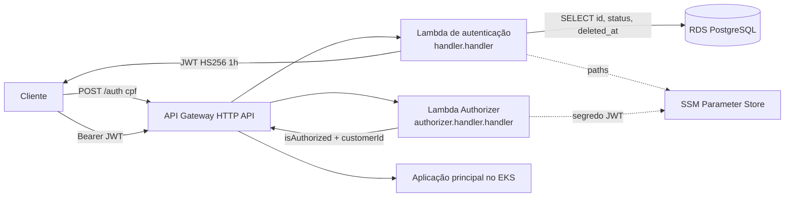

# Function Serverless de Autenticação — Tech Challenge Fase 3

Function Serverless (AWS Lambda) que autentica o **cliente da oficina pelo CPF**: valida o
documento, consulta a existência e o status do cliente na base gerenciada e devolve um
**JWT** válido para consumo das APIs protegidas. O mesmo repositório entrega o **Lambda
Authorizer** que protege as rotas sensíveis na borda do API Gateway.

É um dos quatro repositórios da Fase 3:

| Repositório | Papel |
|---|---|
| [TechChallange](https://github.com/DevKaue/TechChallange) | Aplicação principal em Kubernetes (Fases 1 e 2) |
| **TechChallange---Function-Serverless** (este) | **Function Serverless de autenticação por CPF** |
| [tech-challenge-database-infra](https://github.com/DevKaue/tech-challenge-database-infra) | Banco de dados gerenciado (Terraform) |
| _(a definir)_ | Infraestrutura Kubernetes (Terraform) |

> **Status: código da função e do Authorizer completo, deploy pendente.** Domínio, caso de
> uso, adaptador HTTP, composição no cold start e Lambda Authorizer estão implementados e
> testados (unitário, integração com Postgres real e smoke E2E). Faltam o Dockerfile, o
> Terraform da função e do API Gateway e o workflow de deploy. Seções com comentário `M2`/`M5`
> ainda serão preenchidas.

## Propósito

Duas funções na mesma imagem:

| Função | Entrada | Handler | O que faz |
|---|---|---|---|
| Autenticação | `POST /auth` com `{"cpf": "..."}` | `handler.handler` | Valida o CPF (formato e dígitos verificadores) antes de qualquer I/O, consulta existência e status do cliente no Postgres gerenciado e devolve um JWT HS256 de 1 h |
| Lambda Authorizer | Header `Authorization: Bearer <jwt>` nas rotas protegidas | `authorizer.handler.handler` | Valida assinatura HS256, emissor `techchallenge-auth-lambda`, `type = customer`, expiração e `sub` UUID; libera a rota com `customerId` no contexto |

As duas montam as dependências na **primeira requisição** do container, lendo segredos e
o contrato de descoberta do banco pelo SSM, e reaproveitam nas seguintes. Falha nessa
montagem vira **503 no contrato** (autenticação) ou **negação** (Authorizer), nunca 502 —
ver [ADR-001](docs/ADRs/ADR-001-composicao-no-primeiro-request-e-authorizer-sem-banco.md).

## Tecnologias utilizadas

| Camada | Tecnologia | Justificativa |
|---|---|---|
| Runtime | Node.js 22 + TypeScript | O validador de CPF é portado linha a linha da aplicação principal; duas implementações da mesma regra divergiriam num caso de borda, em produção |
| Empacotamento | Container image no ECR | Atende ao entregável de Dockerfile e permite embutir o bundle de CAs do RDS, fechando a dívida de TLS declarada no repositório-base |
| Banco | `pg` (driver direto), sem ORM | O schema pertence a outro repositório; um `schema.prisma` copiado seria uma segunda fonte de verdade que compila mesmo divergente |
| Token | `jsonwebtoken`, HS256 | Mesmo segredo e mesmo algoritmo da aplicação principal |
| Testes | Jest + Postgres em service container | Mesma estratégia do repositório-base |
| IaC | Terraform `~> 1.10` | Função, alias, role de execução e observabilidade |
| CI/CD | GitHub Actions com OIDC | Sem chave estática em secret de repositório |

## Passos para execução e deploy

### Testes locais

```bash
nvm use                      # Node 22
npm ci
npm run typecheck && npm run lint
npm test                     # unitários + contratos, com cobertura mínima global

npm run db:it:up             # Postgres 15.19 em Docker, porta 5432
npm run test:integration     # repositório e fluxo completo contra o banco real
npm run db:it:down
```

### Variáveis de ambiente da função

| Variável | Autenticação | Authorizer | Exemplo |
|---|---|---|---|
| `APP_ENV` | obrigatória | obrigatória | `homolog` |
| `JWT_SECRET_SSM_PATH` | obrigatória | obrigatória | `/techchallenge/homolog/auth/jwt-secret` |
| `DB_SSM_PREFIX` | obrigatória | — | `/techchallenge/homolog/db` |
| `RDS_CA_BUNDLE_PATH` | opcional | — | padrão `/var/task/certs/global-bundle.pem` |

Só **paths** do SSM entram como variável, nunca valores. Os parâmetros do banco
(`host`, `port`, `name`, `username`, `password`) são publicados pelo repositório
[tech-challenge-database-infra](https://github.com/DevKaue/tech-challenge-database-infra).

### Smoke pós-deploy

```bash
API_URL=https://<api>.execute-api.us-east-1.amazonaws.com \
CPF_ATIVO=<cpf sintético do seed de homologação> \
PROTECTED_URL=https://<api>/<rota protegida> \
test/e2e/smoke-auth.sh
```

<!-- M5 — Dockerfile, Runtime Interface Emulator e deploy por alias com rollback -->

## Diagrama da arquitetura deste repositório



Fonte em [`docs/diagrams/01-autenticacao.mmd`](docs/diagrams/01-autenticacao.mmd).

## Contrato da API

<!-- M2 — a função NÃO é NestJS, então o OpenAPI não é gerado automaticamente:
     docs/api/openapi.yaml é escrito à mão e a coleção Postman é versionada em
     docs/postman/ -->

| Status | Quando |
|---|---|
| 200 | CPF válido, cliente existente e elegível |
| 400 | Formato ou dígito verificador inválido — sem tocar no banco |
| 401 | Cliente não cadastrado **ou** não elegível, indistinguíveis |
| 503 | Banco indisponível |

O 401 é deliberadamente indistinguível entre "não existe" e "não elegível": diferenciar
permitiria enumeração de CPF a partir de listas vazadas. O motivo real fica no log
estruturado, correlacionado pelo `correlationId` devolvido no corpo.

Contratos versionados em [`contracts/`](contracts): resposta pública, payload do JWT e
tabela de erros, validados em teste contra o token **real** emitido pelo assinador.

### Lambda Authorizer (HTTP API, payload 2.0, resposta simples)

| Situação | Resposta | Motivo no log (`authz.denied`) |
|---|---|---|
| Token válido | `isAuthorized: true`, contexto `customerId` e `principalType` | `authz.allowed` |
| Sem header ou fora do formato `Bearer <jwt>` | negado | `missing_token`, `malformed_header` |
| Expirado, ainda não válido | negado | `expired`, `not_yet_valid` |
| Outro segredo, `alg: none`, HS512 | negado | `invalid_signature_or_alg` |
| JWT administrativo da aplicação (sem `iss`) ou `type` diferente | negado | `wrong_issuer`, `wrong_type` |
| Segredo não carregado do SSM | negado (fail closed) | `bootstrap.error` |

O token nunca é registrado em log, em nenhuma forma.

## Custo estimado

<!-- M2 — tabela em US$/dia -->

## Dívidas conscientes

| Dívida | Por que foi aceita | Quando deixa de ser aceitável |
|---|---|---|
| O Authorizer não consulta o status do cliente | Uma consulta por requisição protegida multiplicaria conexões no RDS pelo tráfego da aplicação inteira | Quando bloquear um cliente precisar valer em menos de 1 h (o `exp` do token) |
| Segredo HS256 compartilhado com a aplicação principal | Mesmo algoritmo e segredo que a aplicação já valida, sem mudança do lado de lá | Quando um terceiro precisar validar tokens: aí o caminho é RS256 com JWKS |
| Sem RDS Proxy | `max: 1` por container e tráfego acadêmico; o alarme de conexões do repositório de banco é o gatilho | Quando o alarme `rds-conexoes` disparar |

<!-- M2 — completar com as dívidas de empacotamento e deploy -->

## Documentação

- [ADRs](docs/ADRs) — decisões arquiteturais permanentes
- [RFCs](docs/RFCs) — propostas técnicas em discussão
- [CONTRIBUTING.md](CONTRIBUTING.md) — commits, branches, merge e revisão
