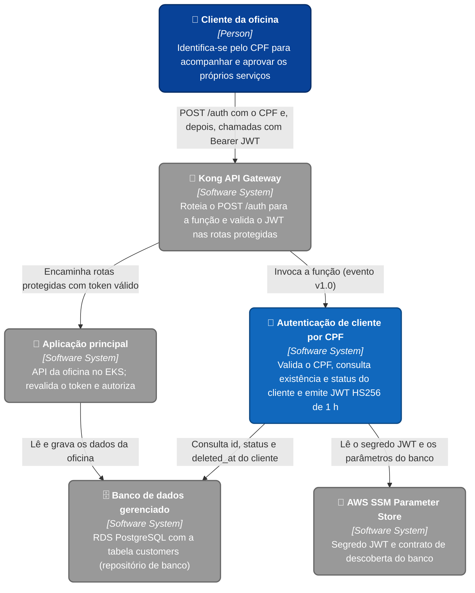
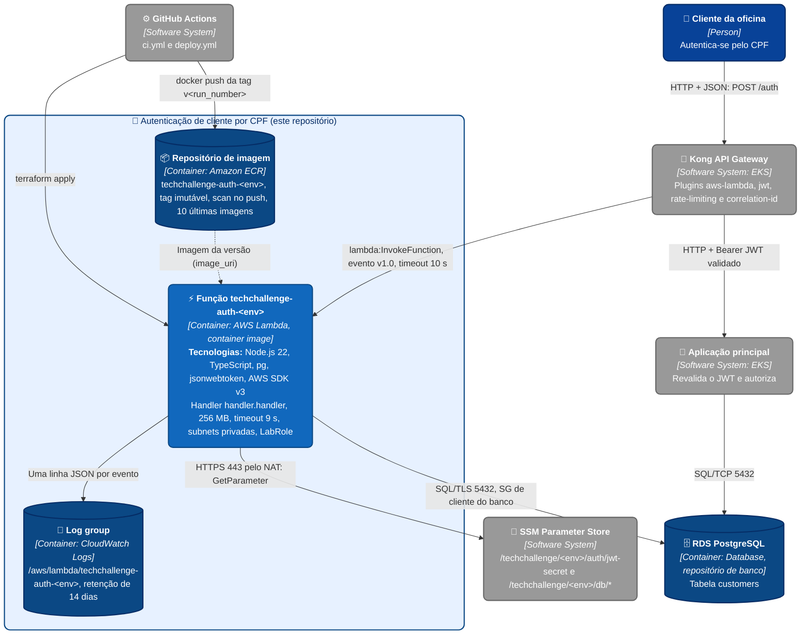
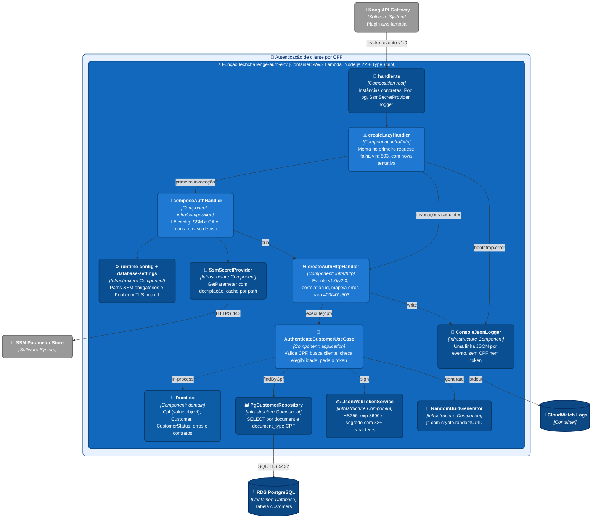

# C4 Model - Function Serverless de autenticação por CPF

Este documento reúne os diagramas C4 em Mermaid para visualização direta no GitHub. O
sistema em foco é a função `techchallenge-auth-<env>` deste repositório; Kong, aplicação
principal, banco e SSM aparecem como sistemas externos porque são provisionados e mantidos
pelos outros repositórios da Fase 3.

Arquivos-fonte:

- [context.mmd](context.mmd)
- [container.mmd](container.mmd)
- [components.mmd](components.mmd)

## Nível 1 - Contexto

O cliente da oficina nunca chama a função diretamente: o único ponto de entrada é o Kong,
que invoca a função no `POST /auth` e valida o token emitido por ela nas rotas protegidas.

## Nível 2 - Container

Este repositório entrega três containers: a função em si (imagem de container), o
repositório ECR que guarda as versões da imagem e o log group com retenção definida. Não há
API Gateway, Lambda Authorizer nem permissão de invocação criados aqui
([ADR-002](../ADRs/ADR-002-kong-invoca-a-funcao-sem-api-gateway.md)).

## Nível 3 - Components

A função segue três camadas — `domain/`, `application/` e `infra/`. Só `infra/` e o
`handler.ts` importam `aws-lambda`, `@aws-sdk/*`, `pg` ou `jsonwebtoken`, e o ESLint
reprova esses imports dentro de `domain/` (`no-restricted-imports`). A montagem das dependências
acontece na primeira invocação de cada container, e uma falha nessa etapa vira 503 no
contrato, nunca 502 ([ADR-001](../ADRs/ADR-001-composicao-no-primeiro-request-e-authorizer-sem-banco.md)).

